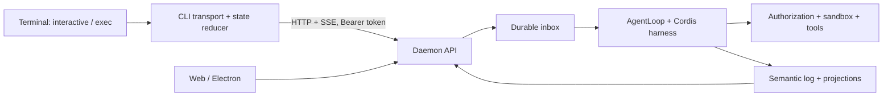

# Thiết kế CLI cho ohmyt

Trạng thái: **đã triển khai CLI ban đầu; phần parity dài hạn vẫn là đề xuất**.
Ngày khảo sát và triển khai: 2026-10-26. Xem [hướng dẫn CLI](../cli.md) cho
commands, contracts và giới hạn thực tế. Các phần “đề xuất” bên dưới là thiết
kế đích, không phải bằng chứng mọi chi tiết đã có.
Tên lệnh đề xuất là `ohmyt`; tên npm hiện tại vẫn là `sky`.

Định hướng theo yêu cầu người dùng: **trải nghiệm gần Codex CLI nhất có thể**.
Mức tương đồng được đánh giá bằng thao tác thực tế: mở terminal là dùng được,
composer nhiều dòng, transcript/tool/diff, slash commands, resume và exec.
Readline đơn giản chỉ là milestone kỹ thuật, không phải giao diện hoàn thành.

## 1. Quyết định kiến trúc

CLI là một client Node.js của daemon hiện có. Web, Electron và terminal dùng
chung session, inbox, harness, provider, authorization và persistence. Không tạo
agent loop hoặc cơ sở dữ liệu hội thoại riêng trong CLI. Giữ một npm package,
`package-lock.json` và backend JavaScript ES modules.



Phạm vi đầu tiên: giao việc bằng text, theo dõi kết quả, chat nhiều lượt,
resume, approval, human input, dừng tác vụ và JSONL cho script. Browser cần
desktop bridge thì báo capability tương ứng; headless daemon không giả lập
khả năng điều khiển trình duyệt native. Attachment, document tabs, quản trị
MCP/plugins và goals để sau. TUI composer/status bar là điều kiện nghiệm thu
trải nghiệm, không phải phần trang trí tùy chọn.

## 2. Học gì từ Codex

Khảo sát source ở commit
[`970111f6cb62cc02fe36a82ea7d71b37a2889c97`](https://github.com/openai/codex/tree/970111f6cb62cc02fe36a82ea7d71b37a2889c97).
Đây là ảnh chụp source, không bảo đảm mọi nhánh có trong bản npm đã phát hành.

| Source Codex | Điều quan sát được | Áp dụng cho ohmyt |
| --- | --- | --- |
| [`codex-cli/bin/codex.js`](https://github.com/openai/codex/blob/970111f6cb62cc02fe36a82ea7d71b37a2889c97/codex-cli/bin/codex.js) | Node launcher chọn native binary theo OS/CPU, chuyển argv/stdio/signals | Entry point mỏng; ohmyt chạy Node trực tiếp, chưa cần native binary |
| [`cli/src/main.rs`](https://github.com/openai/codex/blob/970111f6cb62cc02fe36a82ea7d71b37a2889c97/codex-rs/cli/src/main.rs) | Parser/dispatch phân biệt interactive và `exec` | Tách chế độ chat và chế độ script |
| [`exec/src/lib.rs`](https://github.com/openai/codex/blob/970111f6cb62cc02fe36a82ea7d71b37a2889c97/codex-rs/exec/src/lib.rs) | Event processors riêng cho human output và JSONL; sử dụng in-process app-server client | Một transport/state model, hai renderer; stdout có hợp đồng rõ |
| [`tui/src/lib.rs`](https://github.com/openai/codex/blob/970111f6cb62cc02fe36a82ea7d71b37a2889c97/codex-rs/tui/src/lib.rs) | Có cả in-process và remote app-server clients | Tách presentation khỏi runtime; ohmyt chọn HTTP/SSE vì đã có daemon |

Codex có nhiều cách host runtime; không suy ra rằng mọi lần chạy Codex đều
kết nối một HTTP daemon bên ngoài. ohmyt cũng không cần chuyển sang Rust hay
JSON-RPC để áp dụng cách phân lớp này. Nếu sau này lấy code thay vì chỉ tham
khảo kiến trúc, giữ license và ghi provenance theo quy định repo.

## 3. Nền tảng sẵn có và khoảng trống

| Đã có trong ohmyt | Source | Hệ quả |
| --- | --- | --- |
| `createDaemon()` nhận port, dataDir, authToken và có `stop()` drain/cleanup | [server/index.js](../../server/index.js) | Có thể host headless, nhưng cần executable quản lý lifecycle |
| Session/project API, canonicalize project path và kiểm tra overlap | [sessions_and_projects_routes.js](../../server/api/sessions_and_projects_routes.js) | CLI dùng API, không ghi SQLite trực tiếp |
| Durable inbox với `clientMessageId` và fingerprint | [inbox.js](../../server/harness/inbox.js) | Retry submission giữ nguyên ID và nội dung |
| Semantic session events và run SSE có cursor riêng | [harness_routes.js](../../server/api/harness_routes.js), [runs_routes.js](../../server/api/runs_routes.js) | History và live activity có thể dựng lại |
| Duyệt quyền, pause/resume/abort và human input | Hai route modules trên | CLI cần UI cho cả approval lẫn câu hỏi, không chỉ in text |
| Electron tạo token ngẫu nhiên, runtime port 0 | [electron/main.cjs](../../electron/main.cjs), [desktop_runtime.js](../../server/desktop_runtime.js) | Không thể mặc định desktop luôn ở port 3188 |

Khoảng trống cần bổ sung trước khi gọi là CLI hoàn chỉnh:

- Discovery có xác thực và version/capability handshake; `/api/status` hiện có
  kiểm tra LLM health, không phù hợp làm probe kết nối nhẹ.
- Hợp đồng công khai từ inbox submission tới run/outcome. Hiện
  `pumpInbox()` dùng `run_queue_${inboxId}`; CLI không nên phụ thuộc quy tắc tên này.
- Snapshot approval đang pending để reconnect không hiện lại yêu cầu đã hết hạn.
- Lifecycle lock chung cho desktop/headless nếu cùng sử dụng một dataDir.
- Hợp đồng JSONL/exit code và kiểm thử terminal.

## 4. Giao diện lệnh đề xuất

Các lệnh dưới đây là thiết kế tương lai, chưa chạy được trong repo hiện tại.

```sh
ohmyt                              # chọn project theo cwd, mở chat mới
ohmyt -C /path/to/project           # chọn thư mục rõ ràng
ohmyt "giải thích project này"      # chat với prompt đầu tiên
ohmyt exec "sửa lỗi và chạy test"   # một submission, chờ kết quả rồi thoát
cat task.txt | ohmyt exec -         # stdin là prompt khi dùng dấu -
ohmyt exec --json "kiểm tra build"  # stdout JSONL
ohmyt sessions list
ohmyt resume SESSION_ID             # xem lại và tiếp tục, không tự gửi prompt
ohmyt resume --last                 # chat gần nhất trong project hiện tại
ohmyt fork SESSION_ID               # nhánh mới, giữ project scope
ohmyt review                       # review thay đổi, không tự sửa file
ohmyt status
ohmyt doctor
ohmyt daemon start --data-dir /path/to/runtime
ohmyt daemon stop
```

`-C` mặc định là cwd. Backend realpath/validate và resolve project đã đăng ký
chứa cwd; không tự đăng ký thư mục con lồng nhau. Nếu chưa có project, interactive
hỏi đăng ký thư mục; exec yêu cầu `--create-project` rõ ràng. Project root chứa
dataDir bị từ chối theo policy hiện có. CLI mới không mặc định tạo standalone
host session khi người dùng đang muốn thao tác project.

Resume giữ project của session. Nếu `-C` không thuộc project đó, báo mismatch,
không PATCH để chuyển scope. `resume` chỉ đọc lại history và attach run đang
chạy; không tự khởi động lại run thất bại hoặc arm goal sau restart.

Khi chat đang chạy, input mới mặc định enqueue; `/steer TEXT` là yêu cầu steering
rõ ràng; `/pause`, `/continue`, `/stop` đi qua API. `/exit` khi đang chạy hỏi
dừng hay detach. Exec trên session bận mặc định trả conflict; `--enqueue` cho
phép chờ theo inbox ID của chính submission đó, không theo “run mới nhất”.

Không có prompt + không có TTY: trả usage error. `exec -` đọc stdin đến EOF,
giới hạn 100.000 ký tự theo inbox hiện tại và từ chối input rỗng. Không dùng
stdin chứa prompt để nhận approval. Cấu hình model/provider ở daemon; CLI
không đọc hoặc sao chép provider secrets. MVP chưa có override model per-run.

## 5. Kết nối, xác thực và lifecycle

Milestone đầu chỉ attach runtime đang chạy để kiểm tra contracts. Bản giao cho
người dùng phải tự attach đúng runtime hoặc tự start headless khi chưa có:
`cd project && ohmyt` không bắt buộc chạy `npm run daemon` trước. Auto-start chỉ
bật sau khi lock/discovery ổn định, dùng profile/dataDir đã chọn; chưa có profile
thì onboarding một lần, không âm thầm dùng dataDir của profile khác. Backend
giữ trạng thái unavailable nếu project sandbox không hỗ trợ, không fallback host.

Discovery sử dụng thư mục runtime control riêng theo user/profile, nằm ngoài
project. Mỗi instance có descriptor version 1 gồm instanceId, pid, loopback
endpoint, protocolVersion, profileId, dataDir identity và ownerKind
(`desktop` hoặc `headless`). Token lưu trong file riêng cùng thư mục; POSIX
directory 0700/file 0600, Windows ACL chỉ user hiện tại. Không lưu token vào
repo, argv, URL query hoặc logs. Descriptor là dữ liệu runtime, không commit.

Thứ tự chọn: endpoint chỉ định rõ, profile được chọn, rồi instance duy nhất
trong discovery. Nhiều instance mà chưa chọn thì interactive cho chọn; exec
trả lỗi ambiguous. Không đoán một profile khác khi endpoint/token không hợp lệ.
Explicit endpoint phải là loopback, không theo redirect và token lấy từ file
user chỉ định. Không gửi token tới địa chỉ remote. Runtime chưa xác thực chạy
bằng `npm run daemon` hiện tại chỉ được attach bằng lựa chọn dev rõ ràng;
không tự hạ mức xác thực khi desktop attach thất bại.

Đề xuất thêm `GET /api/runtime`: instanceId, protocolVersion=1, profileId và
capabilities; đi qua auth middleware hiện có, không probe provider, không trả
secrets. Descriptor ghi atomically sau khi listen thành công. Client xác minh
instanceId qua handshake, không chỉ tin PID còn sống. Mất instance giữa run
thì báo disconnected, không tự attach instance mới hoặc replay submission.

Desktop tiếp tục sở hữu utility process và native browser bridge. Publish
discovery descriptor khi nhận `ready`, xóa khi shutdown nếu instanceId còn
khớp. `daemon stop` không được giết desktop-owned runtime; hướng dẫn đóng app.
CLI detach không dừng shared daemon.

Headless `daemon start` cần executable mới, gọi `createDaemon()` với config
tường minh, hostEnabled=false mặc định, port 0 và token. DataDir phải rõ ràng;
không đổi default path hiện có hoặc tự migrate data. Một lock OS theo canonical
dataDir áp dụng cả Electron và headless, giữ suốt lifetime; stale metadata không
đủ lý do xóa lock của process sống. Nếu lock đang có owner, attach đúng owner
hoặc báo conflict, không mở daemon thứ hai trên cùng app.db.

Headless launcher nhận SIGINT/SIGTERM/IPC shutdown và await `daemon.stop()`.
`daemon stop` xác minh instance identity rồi dùng kênh local IPC riêng của owner,
không thêm HTTP kill endpoint chung. Khả năng lock/IPC đa nền tảng cần lựa chọn
implementation trong phase lifecycle; chưa coi PID file đơn giản là đủ.

## 6. API và state machine

Giữ endpoints, payload và error conventions hiện có; bổ sung trường theo kiểu
additive. Không tạo API thứ hai dành riêng cho CLI.

| Hành động | API hiện có / phần đề xuất |
| --- | --- |
| Chọn project, tạo chat | `GET/POST /api/projects`, `POST /api/sessions` |
| History chuẩn | `GET /api/sessions/:id/events?afterSeq=N` |
| Stream history/control | Cùng endpoint với `stream=1`, cursor `sessionId:seq` |
| Gửi prompt | `POST /api/sessions/:id/inbox` với `{clientMessageId,kind:'queued',content}` |
| Theo dõi submission | **Mới:** `GET /api/sessions/:id/submissions/:clientMessageId` |
| Live run activity | `GET /api/runs/:id/stream`, `Last-Event-ID: e_runId_sequence` |
| Khôi phục câu hỏi | `GET /api/sessions/:id/user-input` |
| Trả lời | `POST /api/runs/:runId/user-input/:requestId` theo payload hiện có |
| Khôi phục approval | **Mới:** `GET /api/runs/:id/approvals`, snapshot từ PermissionEngine |
| Duyệt quyền | `POST /api/runs/:id/permission`, `{requestId,decision}` |
| Dừng/tạm dừng/tiếp tục | `POST /api/runs/:id/abort`, `/pause`, `/resume` |

Submission lookup trả `{submissionId,clientMessageId,sessionId,status,runId,
outcome,settled}`. Backend sở hữu mapping và status chuẩn hóa
`queued|running|completed|failed|aborted|cancelled|interrupted`.
`settled` chỉ true khi cleanup/session ownership đã được giải phóng. Không
đổi status nội bộ của inbox; route đọc và chuẩn hóa từ inbox/run/host. Mapping
và trạng thái terminal phải truy xuất được sau restart; thêm persistence hoặc
phép tra cứu backend rõ ràng, không suy từ activeRunId của session.
Không coi `consumed` là completed. Missing resource trả 404, ID collision
khác payload trả 409 có code ổn định; không đoán từ chuỗi thông báo.

Luồng gửi: tạo UUID và giữ payload -> lấy cursor session -> enqueue -> reconcile
submission -> attach run SSE -> dựng kết quả bằng semantic projection -> chờ
terminal và settled. Nếu POST mất response, retry có giới hạn với đúng UUID/
payload; không tạo UUID mới. Có thể query lookup trước retry. Không tự retry
POST run, permission hoặc tool mutation khi kết quả chưa rõ.

Hai stream có cursor/dedupe riêng. Session log sở hữu transcript/control;
run stream cung cấp activity, delta, approval và input notifications. Reducer
không append cùng assistant message hai lần từ hai nguồn. Reconnect resume từ
cursor, reconcile pending input/approval và submission. Không replay history
thành tool invocation. Session deletion revision làm vô hiệu cache cũ; hỗ trợ
compatibility history fallback như client hiện có nếu session chưa có semantic
projection đầy đủ. Nếu cursor/instance không còn hợp lệ, fetch lại snapshot,
không tự gửi lại tác vụ.

`RunCompleted` không đồng nghĩa mọi cleanup đã xong hoặc task thành công.
Exec chỉ trả success khi submission completed, outcome không báo failure/
blocked/partial và settled=true; interrupted/unknown sau restart cần người
dùng quyết định. Chỉ lấy final answer thuộc turn/run đó.

## 7. Approval, human input và cancellation

Interactive hiện đúng tool, target, scope và lý do đang chờ; mặc định chọn
DENY. MVP cung cấp ALLOW_ONCE và DENY. ALLOW_ALWAYS có thể thêm sau bằng thao
tác riêng giải thích grant scope; không có cờ CLI bypass sandbox/deny policy.
Trước khi hiện hoặc gửi approval sau reconnect, refresh pending snapshot.
Nếu web đã trả lời, CLI bỏ prompt cũ; backend vẫn là nơi phân xử race.

Human input dùng question/options/free text hiện có, hỗ trợ skip nếu API cho
phép. Đây là dữ kiện, không phải approval. `request_project` trả continuation
thì dừng turn standalone và tạo session project mới theo hợp đồng hiện có;
không đổi scope của session cũ. MVP project-first tránh nhánh này cho việc
thông thường nhưng vẫn phải xử lý nếu resume một standalone session.

Exec không tương tác: gặp approval hoặc human input bắt buộc thì emit
`interaction.required`, yêu cầu abort submission của chính lệnh, chờ settle
trong thời hạn hữu hạn rồi thoát 3. Không auto-approve, không tự bịa câu trả lời
và không để run tiếp tục mutation âm thầm. Cần áp dụng cho cả child request
hiển thị qua parent session. Policy/grant backend đã có vẫn có hiệu lực.

Ctrl+C lần đầu trong active CLI run gửi abort, in “đang dừng”, chờ drain.
Lần thứ hai thoát 130 và ghi rõ cleanup chưa được xác nhận; không kill shared
daemon. Nếu submission còn queued thì cancel inbox item. Nếu queued→running
race, reconcile rồi abort đúng run. Observe-only resume không tự abort run
do client khác khởi tạo. Mất kết nối không có nghĩa run đã bị dừng.
Broken stdout pipe trong exec cũng thực hiện best-effort cancel và báo trạng
thái trên stderr; interactive luôn restore raw mode/cursor trong finally.

## 8. Output cho người và script

Prototype transport có thể dùng `node:readline`; giao diện hoàn thành dùng TUI
với composer và status bar, transcript cuộn, input nhiều dòng, activity gọn,
prompt approval và câu hỏi. In rõ project/session/model, đang chờ ai và đang
dừng hay đã dừng. Chọn renderer sau terminal spike; có thể dùng Ink nếu giảm
độ phức tạp của focus/resize, không tự viết terminal emulator. Không cần
alternate screen nếu transcript trong scrollback cho trải nghiệm tốt hơn.
Escape control sequences từ model/tool/file text, gồm OSC/clipboard và ANSI;
không để external text điều khiển terminal. Renderer có backpressure, giới hạn
preview tool output, hỗ trợ Unicode và NO_COLOR.

`exec` text: stdout chỉ final answer; tiến trình/cảnh báo/session ID ở stderr.
`exec --json`: stdout chỉ JSONL version 1, mỗi dòng một event:

```json
{"v":1,"type":"submission.accepted","sessionId":"sess_x","submissionId":"item_x"}
{"v":1,"type":"run.started","sessionId":"sess_x","runId":"run_x"}
{"v":1,"type":"assistant.delta","runId":"run_x","text":"Đang kiểm tra"}
{"v":1,"type":"run.completed","runId":"run_x","settled":true,"outcome":{"status":"success"},"answer":"Đã sửa lỗi."}
```

Đây là public CLI envelope đề xuất, không phải tên payload backend hiện tại.
Adapter map từ contracts thực tế; giữ source event ID khi có, dedupe theo
stream, không hứa exactly-once stdout sau crash process. Internal diagnostic
events/provider secrets không đẩy nguyên xi vào public output. Sau khi biết
runId, mọi event liên quan đều có runId; reconnect có thông báo trạng thái.

Exit codes: 0 completed thành công; 1 task failed/blocked/partial/interrupted;
2 sai arguments/config/scope hoặc conflict; 3 cần tương tác; 4 mất kết nối/
protocol incompatible/outcome chưa xác định; 130 bị interrupt. Error JSONL
có code và IDs nếu biết; stderr cho thông báo người đọc. Nếu abort chưa xác
nhận được do disconnect, exit 4 và nói rõ outcome unknown.

## 9. Bố cục source đề xuất

```text
bin/ohmyt.js                   shebang, gọi main, exit handling
cli/main.js                    parseArgs, command dispatch
cli/runtime_connection.js      discovery, auth, handshake
cli/client.js                  HTTP + SSE, bounded reconnect
cli/state.js                   reducers, dedupe, submission tracking
cli/commands/                  chat, exec, resume, status, doctor
cli/render/                    interactive, text, jsonl, terminal escaping
server/runtime/                discovery publication, lock, owner IPC
shared/cli_protocol.js         version/schema thuần, không Node imports
test/cli/                      transport, process, terminal regressions
```

Thêm `bin: {"ohmyt":"bin/ohmyt.js"}` vào package hiện có; phát triển qua
`node bin/ohmyt.js` hoặc npm link, không đổi tên package để có tên lệnh.
Dùng Node hỗ trợ `node:sqlite` và test TypeScript của repo, không sao chép mức
Node >=16 từ launcher Codex. Transport/parser ưu tiên standard library;
dependency TUI cần được đánh giá bằng prototype và giữ lockfile. Không import
`src/api.ts` vì chứa window/sessionStorage/documents browser state. Có thể
trích contracts/projection thuần sang shared khi đã kiểm tra dependencies;
CLI client không import trực tiếp DB/tools/harness.

## 10. Thứ tự triển khai và điều kiện nghiệm thu

1. **Contracts và attach:** runtime handshake, submission lookup, pending
   approvals, client HTTP/SSE và `status`/`doctor`. Explicit endpoint/token-file
   trước; schema/version tests và kiểm tra auth/foreign IDs tại backend.
2. **Exec:** project/session creation, inbox idempotency, outcome/settlement,
   stdout/stderr/JSONL, non-TTY, signals. Fixture provider và temporary dataDir;
   chưa cần desktop hoặc model live.
3. **Interactive/resume:** readline, history projection, câu hỏi/approval,
   steering và terminal restoration. Kiểm thử process thật qua PTY.
4. **Desktop/headless lifecycle:** shared lock, secure discovery, IPC shutdown,
   packaging và descriptor cleanup. Sau khi kiểm tra race/lock, bật auto-start.
5. **Codex-like TUI:** composer/status bar, command picker, transcript expansion,
   diff, review/fork và resume picker. Đủ parity P0 bên dưới mới coi trải nghiệm
   terminal hoàn thành; không dừng ở milestone readline.

Regression bắt buộc: mất response sau enqueue không chạy hai lần; hai client
cùng chat không nhận nhầm final; reconnect không lặp text/approval; web trả lời
trước CLI; input từ child; stop khi đang approval hoặc shell đang drain; queued
cancel race; restart không arm goal/replay tool; scope mismatch/symlink root
change/sandbox unavailable; stale descriptor/token/instance; concurrent daemon
start cùng dataDir; JSONL không lẫn logs; Unicode/terminal escape/broken pipe.

Mỗi phase chạy targeted `node test/cli/test_*.js` (sẽ thêm), matching harness/
approvals/sandbox regressions khi chạm runtime. Kiểm tra `npx tsc --noEmit` và
`npm run build` nếu thay shared/frontend. Electron lifecycle cần kiểm tra
Linux xvfb/Electron; sandbox cần provider thực tương ứng. Fixture chỉ chứng
minh control logic, không chứng minh chất lượng model hay tương đương sandbox
trên mọi OS.

Tiêu chí hoàn thành MVP: từ terminal gửi được tác vụ project, thấy đúng kết
quả trên cả web/desktop cùng runtime, duyệt quyền/trả lời được, dừng có cleanup,
resume không đổi scope và script phân biệt được thành công/thất bại/chưa rõ.

## 11. Mức tương đồng Codex cần đạt

Tham khảo thêm source cùng commit:
[`slash_command.rs`](https://github.com/openai/codex/blob/970111f6cb62cc02fe36a82ea7d71b37a2889c97/codex-rs/tui/src/slash_command.rs),
[`tui/cli.rs`](https://github.com/openai/codex/blob/970111f6cb62cc02fe36a82ea7d71b37a2889c97/codex-rs/tui/src/cli.rs),
[`exec/cli.rs`](https://github.com/openai/codex/blob/970111f6cb62cc02fe36a82ea7d71b37a2889c97/codex-rs/exec/src/cli.rs).
Các hành vi bàn phím và layout dưới đây là mục tiêu của ohmyt; cần đối chiếu
bằng phiên Codex thực tế trước khi tuyên bố khớp từng phím/pixel.

| Ưu tiên | Trải nghiệm mục tiêu | Hợp đồng ohmyt |
| --- | --- | --- |
| P0 | Gõ `ohmyt` là vào chat | Discovery/auto-start có lock, onboarding lần đầu |
| P0 | Header nhỏ, transcript rộng, composer phía dưới | Tên ohmyt, model, project; không logo/branding OpenAI |
| P0 | Streaming markdown/code, tool activity gọn | Delta render mượt; expand để xem output/diff đầy đủ |
| P0 | Composer nhiều dòng và lịch sử nhập | Enter gửi, Alt+Enter xuống dòng; Shift+Enter khi terminal hỗ trợ; paste nhiều dòng không tự gửi |
| P0 | Menu lệnh khi gõ `/` | Lọc theo text, arrows chọn, Enter xác nhận, Escape đóng |
| P0 | Approval ngay trong terminal | Scope/command/target rõ, không tự cấp quyền |
| P0 | Resume và chọn chat | Picker lọc theo project; `--last` xác định bằng backend timestamp và tie-break ID |
| P0 | Chạy script | `exec`, stdin, JSONL và exit code ổn định |
| P0 | Dừng và tiếp tục nhập | Escape đóng menu/modal trước; khi không có modal, Escape dừng run do CLI điều khiển; Ctrl+C theo cancellation contract |
| P1 | `/model`, `/permissions`, `/status` | Dùng model/approval APIs, trạng thái context/budget thực từ daemon |
| P1 | `/diff`, `/review`, `/fork` | Scoped read/review/branch, giữ semantic history và tool-result groups |
| P1 | File/path picker và image attachments | Backend kiểm tra scope và attachment contract hiện có |
| P2 | Quản trị MCP/plugins/goals trong CLI | Cùng revision, idle-only và activation rules của app |

Slash commands đầu tiên: `/help`, `/new`, `/resume`, `/status`, `/model`,
`/permissions`, `/diff`, `/review`, `/fork`, `/exit`. Commands chưa có backend
contract thì chưa xuất hiện như chức năng hoạt động. `/compact` chỉ thêm khi
có endpoint cho bounded summary qua canonical pipeline; không sửa transcript
hay tự gọi model từ CLI. `/pause`, `/continue`, `/stop`, `/steer` là extensions
của ohmyt và phải phân biệt với các thao tác tương tự Codex.

`/diff` đọc git state qua project sandbox và canonical authorization; không
chạy host git từ frontend CLI. `/review` enqueue task workflow review, mặc
định không đề nghị sửa tự động; prompt không phải rào quyền, backend phải áp
dụng capability/policy phù hợp. `/fork` tái dùng session branch API sau khi
kiểm tra actual contract và regression, giữ scope và complete tool groups.
Thay model/permissions áp dụng qua API có kiểm tra trạng thái, không thay cấu
hình global một cách ngầm định. Reasoning effort chỉ hiện nếu provider hỗ trợ.

Input đang chạy không tự trở thành steering: TUI cho chọn “gửi sau” hoặc “chỉ
dẫn ngay”, có trạng thái queue rõ. Approval/human question có focus ưu tiên;
Enter của composer không được vô tình chấp thuận dialog vừa xuất hiện.
Khi resize, Unicode tiếng Việt/emoji, paste dài và output liên tục, composer
phải giữ nội dung/cursor và terminal phải được restore cả khi exception.

Terminal spike bắt buộc trước khi chọn renderer: Linux terminal 80x24 và rộng,
tmux, NO_COLOR, pipe; kiểm tra Windows Terminal/macOS khi có môi trường. Chụp
transcript/PTY fixtures để so UX với source/reference Codex, không coi snapshot
tĩnh là đủ chứng minh focus, keyboard, cancellation hay accessibility.

Mục tiêu tương đồng là cách sử dụng và độ hoàn thiện terminal. Model quality,
tool behavior, remote services và capability riêng của Codex không được tuyên
bố tương đương khi chỉ mới dựng cùng giao diện.

## References

- [Runtime integration and recovery](harness-integration.md)
- [Project isolation](project-isolation.md)
- [Workspace sandbox](workspace-sandbox.md)
- [PTC runtime](ptc-runtime.md)
- [Goal continuation](goal-deepseek-runtime.md)
